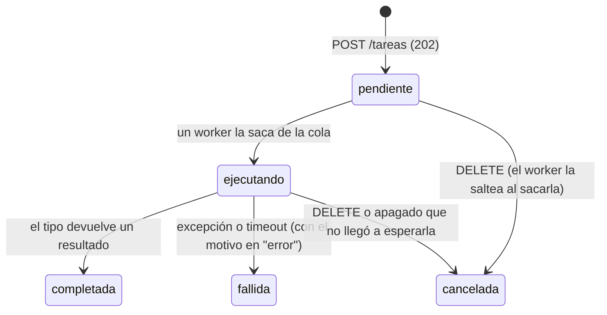

# TP Nº2 — Plataforma de Tareas Distribuidas

**Computación II — Universidad de Mendoza — 2026**

Un servicio HTTP al que se le encargan trabajos (descargar URLs, calcular un
hash iterado, esperar), que los ejecuta de forma concurrente con un pool de
workers sobre `asyncio` y permite consultar su estado, cancelarlos y ver
estadísticas. Todo corre en **un solo proceso y un solo hilo** (el del event
loop), salvo el trabajo CPU-bound, que va a un pool de procesos.

---

## Índice

1. [Descripción y uso](#1-descripción-y-uso)
2. [Arquitectura](#2-arquitectura)
3. [Decisiones de diseño](#3-decisiones-de-diseño)
4. [Mediciones](#4-mediciones)
5. [Conceptos del curso aplicados](#5-conceptos-del-curso-aplicados)
6. [Las preguntas de la corrección](#6-las-preguntas-de-la-corrección)
7. [Limitaciones conocidas](#7-limitaciones-conocidas)
8. [Extensiones (bonus)](#8-extensiones-bonus)
9. [Lo que aprendí](#9-lo-que-aprendí)

---

## 1. Descripción y uso

### Cómo levantarlo

```bash
cd tp2
docker compose up --build
```

Eso levanta dos servicios:

| Servicio | Puerto | Qué es |
|---|---|---|
| `api` | 8000 | La plataforma. Documentación interactiva en <http://localhost:8000/docs> |
| `lento` | 8001 | Servidor auxiliar que responde con demora y tamaño controlados, para probar y medir descargas sin depender de internet ([app/servidor_lento.py](app/servidor_lento.py)) |

Para apagarla: `Ctrl+C` o `docker compose down`. Las dos le mandan SIGTERM al
contenedor, que dispara el apagado ordenado (§3.6); SIGINT hace lo mismo
(`docker kill --signal=SIGINT tp2-api-1`, o Ctrl+C si se corre sin Docker con
`python -m app.main`). El estado queda en `tp2/datos/estado_<timestamp>.json`, y
al volver a levantarla se reporta por log.

### Tipos de tarea

| `tipo` | `params` | Naturaleza | Qué hace |
|---|---|---|---|
| `descargar` | `urls`: lista de 1 a 100 URLs http(s) · `concurrente` (default `true`) | I/O-bound | Descarga todas a la vez y devuelve, por URL, código HTTP, bytes y segundos |
| `hashear` | `texto` · `iteraciones` · `ejecutor`: `procesos` (default), `hilos` o `ninguno` | CPU-bound | Aplica SHA-256 N veces. `ninguno` congela el event loop a propósito y está deshabilitado salvo `PERMITIR_BLOQUEANTE=si` (es para la medición 2) |
| `esperar` | `segundos` (0 a 3600) | I/O simulado | Duerme N segundos con `asyncio.sleep` |

Cada pedido acepta además un `timeout` en segundos (si no, vale `TIMEOUT_DEFECTO`).

### Endpoints

| Método | Ruta | Respuestas |
|---|---|---|
| `POST` | `/tareas` | **202** con la tarea en `pendiente` y header `Location` · 422 pedido inválido · 403 `ejecutor: ninguno` deshabilitado · 503 cola llena o apagándose |
| `GET` | `/tareas?estado=…&limite=…` | 200, las más nuevas primero (sin el `resultado`, que puede ser grande). `limite` default 100, máx. 1000 |
| `GET` | `/tareas/{id}` | 200 con estado y resultado · 404 |
| `DELETE` | `/tareas/{id}` | 200 con la tarea ya `cancelada` (en cola **o en ejecución**) · 404 · 409 si ya terminó |
| `GET` | `/estadisticas` | Totales por estado, tiempos promedio de espera y ejecución (también por tipo), workers ocupados, cola |
| `GET` | `/salud` | Para el healthcheck de Docker |

Estados posibles: `pendiente`, `ejecutando`, `completada`, `fallida`, `cancelada`.

### Ejemplos con `curl`

Desde Linux, macOS o Git Bash (en PowerShell, `curl.exe` con las comillas
escapadas, o directamente <http://localhost:8000/docs>).

```bash
# Encolar una descarga: responde al instante (202), sin esperar a que termine.
# Las URLs las resuelve la plataforma desde su contenedor: "lento" es el
# servidor auxiliar del compose. También sirven URLs de internet.
curl -i -X POST localhost:8000/tareas -H 'Content-Type: application/json' -d '{
  "tipo": "descargar",
  "params": {"urls": ["http://lento:8001/lento?segundos=1&kb=20",
                      "http://lento:8001/lento?segundos=2&kb=5"]},
  "timeout": 30}'
```

```text
HTTP/1.1 202 Accepted
location: /tareas/8cbadbe067d34d1291d8caf6b128c3e7

{"id": "8cbadbe067d34d1291d8caf6b128c3e7", "tipo": "descargar", "estado": "pendiente", ...}
```

```bash
curl localhost:8000/tareas/8cbadbe067d34d1291d8caf6b128c3e7
```

A los 0,5 s está `"estado": "ejecutando", "progreso": 0.5` (una de las dos URLs
terminó). A los 2 s:

```json
{
  "id": "8cbadbe067d34d1291d8caf6b128c3e7",
  "tipo": "descargar",
  "estado": "completada",
  "progreso": 1.0,
  "creada": "2026-10-17T17:48:14.447+00:00",
  "iniciada": "2026-10-17T17:48:14.448+00:00",
  "finalizada": "2026-10-17T17:48:16.476+00:00",
  "espera_s": 0.0005,
  "duracion_s": 2.0283,
  "resultado": {
    "concurrente": true, "segundos_total": 2.0282, "ok": 2, "errores": 0,
    "descargas": [
      {"url": "http://lento:8001/lento?segundos=1&kb=20", "codigo": 200, "bytes": 20480, "segundos": 1.0236},
      {"url": "http://lento:8001/lento?segundos=2&kb=5",  "codigo": 200, "bytes": 5120,  "segundos": 2.015}
    ]
  }
}
```

Tardó 2,03 s: lo que la más lenta, no la suma (3 s).

```bash
# Hash iterado en el pool de procesos (el GET muestra el progreso en vivo)
curl -X POST localhost:8000/tareas -H 'Content-Type: application/json' \
  -d '{"tipo": "hashear", "params": {"texto": "computacion2", "iteraciones": 3000000}}'
# → resultado: {"hash": "6fa206de…d273", "iteraciones": 3000000, "ejecutor": "procesos", "segundos": 1.0415}

# Esperar, y cancelarla mientras corre
curl -X POST localhost:8000/tareas -H 'Content-Type: application/json' \
  -d '{"tipo": "esperar", "params": {"segundos": 60}}'
curl -X DELETE localhost:8000/tareas/<id>
# → {"estado": "cancelada", "error": "cancelada por el usuario", "duracion_s": 0.5115, ...}
curl -X DELETE localhost:8000/tareas/<id>
# → 409 {"detail": "la tarea ya está cancelada"}

# Timeout: se vence y queda fallida con el motivo
curl -X POST localhost:8000/tareas -H 'Content-Type: application/json' \
  -d '{"tipo": "esperar", "params": {"segundos": 10}, "timeout": 0.5}'
# → {"estado": "fallida", "error": "timeout: superó los 0.5 s", ...}

# Listar con filtro, y estadísticas
curl 'localhost:8000/tareas?estado=ejecutando'
curl localhost:8000/estadisticas
```

```json
{
  "aceptando": true,
  "tareas": {"total": 3, "pendiente": 0, "ejecutando": 0, "completada": 2, "fallida": 0, "cancelada": 1},
  "workers": {"total": 8, "ocupados": 0},
  "cola": {"en_cola": 0, "capacidad": 1000},
  "tiempos_promedio_s": {"espera": 0.0005, "ejecucion": 1.535},
  "por_tipo": {
    "descargar": {"total": 1, "completadas": 1, "ejecucion_promedio_s": 2.0283},
    "esperar":   {"total": 1, "completadas": 0, "ejecucion_promedio_s": null},
    "hashear":   {"total": 1, "completadas": 1, "ejecucion_promedio_s": 1.0416}
  }
}
```

### Configuración

Variables de entorno (en `docker-compose.yml`); todas tienen default
([app/config.py](app/config.py)):

| Variable | En el compose | Qué controla |
|---|---|---|
| `WORKERS` | 8 | Corrutinas consumiendo la cola |
| `PROCESOS_CPU` | 4 | Procesos del pool para `hashear` |
| `MAX_DESCARGAS` | 100 | Descargas simultáneas en toda la plataforma |
| `MAX_COLA` | 1000 | Tareas pendientes como máximo (después, 503) |
| `TIMEOUT_DEFECTO` | 60 | Timeout de una tarea que no lo indica |
| `TIMEOUT_APAGADO` | 10 | Cuánto se espera a las tareas en curso al apagar |
| `PERMITIR_BLOQUEANTE` | no | Habilita `hashear` con `ejecutor: ninguno` |
| `DIR_DATOS` | /app/datos | Dónde quedan los volcados (montado en `./datos`) |

### Tests y mediciones

```bash
docker compose run --rm --build tests          # 104 tests (pytest + pytest-asyncio), ~10 s
docker compose run --rm --build mediciones     # las 3 mediciones de §4, ~6 min
docker compose run --rm --build mediciones --solo 2              # una sola
docker compose run --rm --build mediciones --solo 3 --series C   # una serie de la 3
```

Las mediciones dejan sus tablas en [mediciones/resultados.md](mediciones/resultados.md)
(y los datos crudos en `resultados.json`).

Para **ver en vivo** el event loop congelado (lo que mide la medición 2):

```bash
PERMITIR_BLOQUEANTE=si docker compose up --build   # PowerShell: $env:PERMITIR_BLOQUEANTE="si"; docker compose up --build
# en otra terminal: un hash de ~5 s que corre EN el event loop...
curl -X POST localhost:8000/tareas -H 'Content-Type: application/json' \
  -d '{"tipo": "hashear", "params": {"texto": "x", "iteraciones": 15000000, "ejecutor": "ninguno"}}'
# ...y mientras tanto esto tarda lo que falte del hash, en vez de milisegundos:
time curl localhost:8000/salud
```

### Estructura

```text
tp2/
├── app/
│   ├── main.py            punto de entrada: uvicorn + señales
│   ├── api.py             endpoints FastAPI y lifespan (arranque/apagado)
│   ├── modelos.py         esquemas Pydantic: validación de pedidos y respuestas
│   ├── plataforma.py      el núcleo: cola, workers, cancelación, timeouts, apagado
│   ├── tipos.py           descargar / hashear / esperar + recursos compartidos
│   ├── hashing.py         el hash iterado (función pura, se manda a otro proceso)
│   ├── tarea.py           modelo de una tarea y sus estados
│   ├── persistencia.py    volcado a JSON y búsqueda de volcados previos
│   ├── config.py          configuración por variables de entorno
│   └── servidor_lento.py  servidor auxiliar para pruebas y mediciones
├── tests/                 104 tests (§8)
├── mediciones/            medir.py, reloj_de_pared.py, resultados.md/.json (§4)
├── Dockerfile             etapas: base → tests / app
└── docker-compose.yml     api, lento, tests (perfil), mediciones (perfil)
```

---

## 2. Arquitectura

### Componentes

```text
        clientes HTTP (curl, /docs, mediciones)
                       │
┌──────────────────────▼─────────── contenedor api ── 1 proceso, 1 hilo, 1 event loop
│  uvicorn  ◄── SIGTERM / SIGINT → Servidor.handle_exit (main.py): flag + apagado
│     │
│  FastAPI (api.py): POST/GET/DELETE /tareas · /estadisticas · /salud
│     │ encolar()                          ▲ estado y resultado
│     ▼                                    │
│  Plataforma (plataforma.py)
│     ├── tareas: dict id → Tarea  (el estado de todo, en memoria)
│     └── asyncio.Queue(MAX_COLA) ──get()──► worker 0 · worker 1 · … · worker N-1
│                                               │  (corrutinas; un supervisor
│                                               │   reemplaza a las que mueren)
│                    una asyncio.Task por ejecución, con asyncio.timeout(tarea.timeout)
│                                               │
│     esperar ─── asyncio.sleep                 │
│     descargar ── Semaphore(MAX_DESCARGAS) ─► httpx.AsyncClient ────────────► lento:8001 / internet
│     hashear ──── loop.run_in_executor ─┐
└────────────────────────────────────────┼─────────────────────────────────
                                         ▼
          ProcessPoolExecutor ("spawn"): PROCESOS_CPU procesos hijos
          (o un ThreadPoolExecutor propio, con ejecutor = "hilos")
```

### Flujo de una tarea



1. `POST /tareas`: Pydantic valida el pedido (unión discriminada por `tipo`,
   [app/modelos.py](app/modelos.py)). `Plataforma.encolar()` crea la `Tarea`,
   la mete en la `asyncio.Queue` con `put_nowait` y responde **202** al instante
   ([app/plataforma.py:166](app/plataforma.py#L166)). No hay ningún `await` en el
   camino: el POST no espera a la tarea.
2. Un worker, que estaba suspendido en `await cola.get()`, se despierta, la marca
   `ejecutando` y crea **una `asyncio.Task` aparte** para ejecutarla
   ([app/plataforma.py:274](app/plataforma.py#L274)). Así `DELETE` puede cancelar
   la tarea sin matar al worker.
3. Esa Task corre el tipo dentro de `asyncio.timeout(tarea.timeout)`
   ([app/plataforma.py:305](app/plataforma.py#L305)). Los tipos reportan progreso.
4. El worker espera la Task y traduce cómo terminó: resultado → `completada`;
   `CancelledError` → `cancelada`; timeout → `fallida` con "timeout: superó los
   X s"; cualquier excepción → `fallida` con el tipo y el mensaje. Al final setea
   un `asyncio.Event` (`tarea.fin`) y vuelve a `cola.get()`.
5. `GET /tareas/{id}` lee la misma `Tarea` del diccionario: lo que se ve es el
   estado en vivo.

---

## 3. Decisiones de diseño

### 3.1 ¿Por qué `asyncio.Queue` y no `queue.Queue`?

Porque `queue.Queue.get()` bloquea **el hilo**, y en este programa el hilo es uno
solo: el del event loop. Un worker esperando trabajo con `queue.Queue` congelaría
toda la API mientras la cola estuviera vacía. `asyncio.Queue.get()` es una
corrutina: si no hay nada, **suspende sólo a ese worker** (le devuelve el control
al loop) y el loop lo despierta cuando alguien hace `put`. `queue.Queue` está
hecha para coordinar *threads* (por eso tiene locks adentro); `asyncio.Queue`,
para coordinar *corrutinas* del mismo hilo, y no los necesita (§6, pregunta 3).

La cola es acotada (`MAX_COLA`): si se llena, `put_nowait` lanza `QueueFull` y
el POST responde **503 con `Retry-After`** en vez de crecer sin límite
([app/plataforma.py:175](app/plataforma.py#L175)). Es *backpressure*: es mejor
decir "ahora no" que quedarse sin memoria.

### 3.2 ¿Cómo evitás que una tarea CPU-bound congele la API?

**Mandando el cálculo a otro proceso con `loop.run_in_executor`**
([app/tipos.py:181](app/tipos.py#L181)). El event loop es un solo hilo que
alterna entre corrutinas *sólo cuando una hace `await`*. Un bucle de 3 s de
SHA-256 no hace ningún `await`: si corre en una corrutina, durante esos 3 s no
corre nada más (ni otras tareas, ni la API, ni los timeouts). La medición 2 lo
muestra: **0 respuestas en 2,8 s** (§4.2). `run_in_executor` le entrega la
función a un pool y devuelve un *future* que la corrutina puede `await`-ear: la
corrutina se suspende y el loop sigue atendiendo.

**¿Por qué procesos y no hilos (`asyncio.to_thread`)?** Por el GIL. El bucle de
hashing es código Python que tiene el GIL tomado casi todo el tiempo (`hashlib`
sólo lo suelta con entradas de 2048 bytes o más, y acá cada entrada son 32). En
un hilo, el cálculo no bloquea el loop, pero **compite con él por el GIL**: el
intérprete se lo pasa cada 5 ms (`sys.getswitchinterval()`), así que cada
respuesta de la API espera turnos. Medido: con hilos el `GET` tarda 12 ms en vez
de 1 ms (§4.2). Con procesos, cada uno tiene su propio intérprete y su propio GIL:
paralelismo real. Dejamos el modo `hilos` como opción justamente para poder medir
la diferencia.

Detalles que importan:

- **En bloques** ([app/tipos.py:39](app/tipos.py#L39)): el hash no se manda
  entero sino en bloques de 100.000 iteraciones (~50 ms). Es posible porque
  `hash_iterado(hash_iterado(x, a), b) == hash_iterado(x, a + b)` (hay un test de
  eso). Entre bloque y bloque la corrutina vuelve a pasar por un `await`: ahí la
  pueden alcanzar una cancelación o un timeout, y ahí se actualiza el progreso.
- **`spawn` en todas las plataformas** ([app/tipos.py:66](app/tipos.py#L66)): con
  `fork`, cada hijo nacería con una copia del padre, incluido el event loop, el
  socket que escucha en :8000 y las conexiones abiertas. `spawn` arranca un
  intérprete limpio y se comporta igual en Linux, macOS y Windows (§4.1 de la
  consigna). El costo es que cada hijo **re-importa el módulo principal**: por eso
  la guarda `if __name__ == "__main__"` ([app/main.py:94](app/main.py#L94)) es
  obligatoria (sin ella, cada hijo levantaría otro servidor), y por eso los
  procesos se **precalientan** al arrancar ([app/tipos.py:120](app/tipos.py#L120)).
- **Los hijos ignoran SIGINT** ([app/tipos.py:42](app/tipos.py#L42)): Ctrl+C en
  una terminal le llega a todo el grupo de procesos. Si los hijos murieran a mitad
  de un bloque, el pool quedaría roto justo durante el apagado ordenado.
- **Pool de hilos propio** para el modo `hilos`, no el executor por defecto del
  loop: asyncio usa ese para resolver DNS (`getaddrinfo`), y llenarlo de hashes
  dejaría a las descargas esperando para resolver nombres.

### 3.3 ¿Cómo implementaste la cancelación, y qué pasa con los recursos a medio usar?

`DELETE /tareas/{id}` ([app/plataforma.py:188](app/plataforma.py#L188)) distingue:

- **En cola (`pendiente`)**: una `asyncio.Queue` no permite sacar un elemento del
  medio, así que la tarea se marca `cancelada` y queda en la cola; el worker que
  la saque la ve cancelada y la saltea ([app/plataforma.py:266](app/plataforma.py#L266)).
- **En ejecución**: se llama `cancel()` sobre **su** `asyncio.Task` (la del paso 2
  del flujo, no la del worker). Eso hace que en el `await` donde está parada se
  lance `CancelledError`, que sube por todo el código de la tarea hasta el worker,
  que la marca `cancelada`. El `DELETE` espera a ese momento (con `tarea.fin`, un
  `asyncio.Event`) y devuelve el estado final: medido, **4 a 9 ms**.

Qué pasa con lo que estaba a medio usar, por tipo:

| Tipo | Dónde la alcanza el `CancelledError` | Qué se libera |
|---|---|---|
| `esperar` | en `asyncio.sleep` | nada que liberar: el timer se descarta |
| `descargar` | en la lectura del socket (`aiter_bytes`) | el `async with cliente.stream(...)` cierra la respuesta y la conexión ([app/tipos.py:215](app/tipos.py#L215)); el `async with` del semáforo devuelve el lugar; el `TaskGroup` cancela las demás descargas de la tarea y **espera a que terminen** antes de seguir ([app/tipos.py:250](app/tipos.py#L250)) |
| `hashear` | en el `await` del bloque que se está calculando | la corrutina termina al instante, pero **el bloque en curso sigue corriendo** en su proceso/hilo hasta terminar (≤ ~50 ms): no se puede interrumpir código que corre en otro proceso; su resultado se descarta. Los bloques que no se llegaron a mandar no se mandan nunca |

Hay tests que lo verifican con un stream falso que registra si lo cierran:
cancelar a mitad de 5 descargas cierra las 5 respuestas y deja
`asyncio.all_tasks()` con sólo la tarea del test (**ninguna corrutina
huérfana**), y lo mismo durante el apagado.

**¿Por qué `TaskGroup` y no `asyncio.gather`?** Ante una *cancelación*, los dos
cancelan a sus hijas. La diferencia está ante una *excepción*: si una descarga
falla con algo que no es un error de red (un bug), `gather` propaga la excepción
**y deja a las demás corriendo solas**. Lo comprobamos con una prueba de
mutación: reemplazando el `TaskGroup` por `gather`, el test
`test_si_una_descarga_explota_las_demas_se_cancelan` falla porque las 3 descargas
hermanas nunca se cerraron.

Los **timeouts** usan el mismo mecanismo: `asyncio.timeout` agenda un `cancel()`
para cuando venza; si vence *nuestro* límite (`limite.expired()`) la tarea queda
`fallida` con "timeout: superó los X s" ([app/plataforma.py:305](app/plataforma.py#L305)).

### 3.4 ¿Qué pasa si un worker lanza una excepción no capturada?

Tres capas:

1. **La excepción de una tarea no llega al worker como excepción**: el worker
   envuelve cada ejecución en `try/except Exception` y la convierte en estado
   `fallida`, con `"TipoDeError: mensaje"` en el campo `error`
   ([app/plataforma.py:295](app/plataforma.py#L295)). Si viene de un `TaskGroup`
   (un `ExceptionGroup`), se abre para mostrar las causas reales. El worker sigue
   con la siguiente tarea. Hay test: una tarea que lanza `ValueError` queda
   fallida y los mismos 2 workers siguen atendiendo.
2. **Si el que falla es el worker mismo** (un bug fuera de ese `try`), la
   corrutina del worker termina con la excepción. Sin nada más, el pool se
   achicaría en silencio hasta quedar en cero workers. Por eso cada worker tiene un
   `add_done_callback` que hace de **supervisor**: loguea el error con el
   traceback y lanza un worker nuevo en su lugar
   ([app/plataforma.py:248](app/plataforma.py#L248)). Hay test que mata un worker
   a propósito y verifica que siguen siendo 2.
3. **Si muere un proceso del pool** (el sistema lo mata por falta de memoria, por
   ejemplo), el `ProcessPoolExecutor` queda marcado como roto y rechaza todo lo
   que se le mande, para siempre. La tarea que se topa con eso queda `fallida`
   (`BrokenProcessPool`), y se arma un pool nuevo para las siguientes
   ([app/tipos.py:106](app/tipos.py#L106)). Hay test que mata un proceso hijo con
   `os._exit`.

### 3.5 ¿Por qué httpx y no aiohttp?

La consigna prohíbe `requests` porque es bloqueante: cada descarga congelaría el
loop. Las dos alternativas asíncronas sirven; elegimos **httpx** porque:

- su API es casi la de `requests` (`client.get`, `client.stream`,
  `raise_for_status`), lo que hace el código fácil de leer;
- es el cliente que usa el propio ecosistema de FastAPI: con él mismo escribimos
  los tests (`httpx.ASGITransport` habla con la app sin red, y
  `httpx.MockTransport` simula servidores con demoras exactas);
- permite timeouts por fase (`Timeout(30, connect=10)`) y streaming con
  `async with`, que es lo que hace limpia la cancelación (§3.3).

Lo que **medimos** en contra: el pool de conexiones de httpx se vuelve caro
cuando cientos de requests esperan una conexión libre (al recorrer la fila en
cada liberación). Con 800 descargas simultáneas, eso duplicaba el tiempo. Lo
resolvimos poniendo la fila **antes** de httpx: un `asyncio.Semaphore(MAX_DESCARGAS)`
global ([app/tipos.py:84](app/tipos.py#L84)), que despierta a la siguiente en
O(1); 800 descargas pasaron de 16,1 s a 9,2 s (el ideal es 8 s, §4.3 serie C).
aiohttp probablemente rinda más a muy alta concurrencia; para esta plataforma la
diferencia no justificaba resignar lo anterior.

### 3.6 Señales y apagado ordenado

**Las señales las atiende uvicorn**: registra con `signal.signal()` un handler
para SIGINT y SIGTERM que sólo levanta un flag (`should_exit`); su loop principal
lo mira cada 0,1 s, deja de escuchar en el puerto, espera las peticiones en curso
y ejecuta el *shutdown* del `lifespan` de la app
([app/api.py:28](app/api.py#L28)), que es donde está nuestro apagado.

Lo extendimos en dos puntos ([app/main.py](app/main.py)):

- **Cortar el ingreso en el instante de la señal**: `Servidor.handle_exit`
  ([app/main.py:41](app/main.py#L41)) además pone `aceptando = False`, así un
  `POST` que llegue entre la señal y el cierre del socket recibe 503. Es un
  handler de señal: sólo toca flags, porque se ejecuta entre dos bytecodes de lo
  que sea que estuviera corriendo.
- **No loguear desde el handler**: si la señal interrumpe al hilo justo mientras
  escribía en stderr, volver a escribir desde el handler puede fallar ("reentrant
  call"). El log se **agenda** con `loop.call_soon_threadsafe()`
  ([app/main.py:63](app/main.py#L63)), que es el mismo truco del *self-pipe* que
  usa asyncio por dentro (y que usamos en el TP1).

Usamos `signal.signal` + flag y no `loop.add_signal_handler()` porque el segundo
sólo existe en Unix: así funciona igual en Windows sin Docker, como sugiere la
consigna en §4.1.

El apagado en sí, `Plataforma.apagar()` ([app/plataforma.py:122](app/plataforma.py#L122)):

1. deja de aceptar tareas y les avisa a los workers que no arranquen nada nuevo;
2. espera **como máximo `TIMEOUT_APAGADO`** a que terminen las que están en curso
   (esperando sus `tarea.fin`, no con *polling*);
3. las que no llegaron se cancelan, con el motivo "cancelada por apagado (no
   terminó en 10 s)";
4. cancela a los workers (que a esa altura están parados en `cola.get()`) y los
   espera;
5. vuelca todas las tareas a `datos/estado_<timestamp>.json` **en un hilo**
   (`asyncio.to_thread`, para no bloquear el loop) y de forma atómica: archivo
   temporal + `os.replace` ([app/persistencia.py:39](app/persistencia.py#L39)),
   así nunca queda un JSON cortado por la mitad;
6. cierra el cliente HTTP y apaga los pools.

Las tareas que estaban en cola quedan como `pendiente` en el volcado (nunca
arrancaron). Al arrancar, si hay volcados en `DIR_DATOS`, se loguea el más
reciente con el conteo por estado y cuántos más hay:

```text
INFO app.plataforma: Volcado previo encontrado: estado_20261017-174649.json — 17 tareas (cancelada: 9, completada: 5, fallida: 1, pendiente: 2)
```

Verificado con señales reales en Docker: con 1 tarea corta, 7 largas y 2 en cola,
`docker compose stop` (SIGTERM) dejó la corta `completada`, las 7 largas
`cancelada` por apagado y las 2 de la cola `pendiente`, con código de salida 0. En
Docker importan dos cosas más: el `CMD` en forma *exec* (lista JSON) para que
Python sea el PID 1 y reciba la señal (con la forma *shell*, el PID 1 sería
`/bin/sh`, que no la reenvía), y un `stop_grace_period` (30 s) mayor que el
apagado, para que Docker no lo mate con SIGKILL a mitad de camino.

### 3.7 Duraciones con reloj monotónico

Las duraciones (`espera_s`, `duracion_s` y los promedios de `/estadisticas`) se
calculan con `time.monotonic()`, no con `time.time()`
([app/tarea.py:67](app/tarea.py#L67)). Lo cambiamos después de **medirlo**: en un
hash que bloqueó el loop 2,97 s, la tarea decía haber durado 1,18 s. Dentro del
contenedor de Docker Desktop, el reloj de pared **salta ~1,8 s hacia atrás cada
~30 s** (la VM de Linux resincroniza su hora con la de Windows);
[mediciones/reloj_de_pared.py](mediciones/reloj_de_pared.py) lo muestra. El
reloj monotónico nunca salta: es el mismo que usa el event loop (`loop.time()`)
para los `sleep` y los timeouts, y por eso el sistema funcionaba bien aunque los
números reportados estuvieran mal. La hora de pared se sigue usando para mostrar
*cuándo* pasó algo (`creada`, `iniciada`, `finalizada`). Hay un test con un reloj
falso que salta.

### 3.8 Otras decisiones

- **Todos los endpoints son `async def`.** FastAPI ejecuta los `def` comunes en un
  pool de hilos; si estos lo fueran, tocarían el estado de la plataforma desde
  otro hilo mientras el loop lo modifica, y ahí sí harían falta locks.
- **202 Accepted + `Location`**: el POST no hizo el trabajo, lo aceptó.
- **Validación estricta**: un campo mal escrito (`"segudos"`) es un 422, no algo
  que se ignora en silencio.
- **`GET /tareas` tiene un `limite`** (default 100, máximo 1000) y no devuelve el
  `resultado`: serializar miles de tareas a JSON es CPU que se gasta en el hilo
  del loop.
- **`ejecutor: ninguno` responde 403 por defecto**: existe sólo para la medición
  2; habilitado, cualquier cliente podría congelar el servidor.
- **Un 404 en una descarga es una respuesta, no un error**: se reporta su código.
  Los errores de red (DNS, conexión, timeout) se reportan por URL y no hacen
  fallar al resto; la tarea queda `completada` con `ok` y `errores`.

---

## 4. Mediciones

Todos los números son de esta máquina: **Intel Core i7-13700H** (14 núcleos: 6
de rendimiento con *hyperthreading* + 8 de eficiencia; 20 CPUs lógicas), Windows
11 con Docker Desktop (WSL2), Python 3.12.15 en el contenedor. Las tablas
completas, de una sola corrida, están en
[mediciones/resultados.md](mediciones/resultados.md) y se reproducen con
`docker compose run --rm --build mediciones` ([mediciones/medir.py](mediciones/medir.py)).
Cada experimento levanta su propio servidor con la configuración que necesita.

### 4.1 Concurrencia I/O: 20 descargas secuenciales contra 20 concurrentes

Una tarea `descargar` con 20 URLs, con `concurrente: false` (un `await` por vez)
y `true` (un `TaskGroup`). Contra el servidor lento, cada URL tarda entre 0,20 y
0,96 s. Mediana de 3 corridas por modo, alternadas, cada una en un servidor
recién levantado.

| Destino | Secuencial | Concurrente | Speedup | Suma de los tiempos individuales | La más lenta | OK |
|---|---|---|---|---|---|---|
| Servidor lento (local) | 11,769 s | 1,005 s | **11,7x** | 11,768 s | 0,981 s | 120/120 |
| 20 sitios reales de internet | 7,199 s | 1,625 s | **4,4x** | 7,199 s | 1,601 s | 120/120 |

**Interpretación.** La secuencial tarda exactamente la **suma** de los tiempos
individuales y la concurrente, lo que tarda **la más lenta** (más unos 24 ms de
overhead). El speedup no es "20x": es *suma / máximo*, y depende de qué tan
parecidas sean las descargas. Contra el servidor lento da 11,7x; contra internet,
4,4x, porque ahí una sola descarga lenta (1,6 s) domina el total. La variación de
internet es grande entre corridas (en otra dio 3,5x): depende de la red del momento.

En esos 11,8 s la tarea no calcula nada: espera que el servidor responda. La
concurrencia no hace más rápida cada descarga (cada una tarda lo mismo en los dos
modos); hace que las esperas se **superpongan**. Una corrutina que espera un
socket no ocupa el hilo, así que un solo hilo puede tener 20 (o 2.000) esperas en
curso.

### 4.2 El event loop bloqueado

Un hash de ~3 s (8,6 millones de SHA-256) y, mientras corre, un `GET /tareas`
cada 50 ms midiendo cuánto tarda cada respuesta.

| Caso | Duración del hash | GET respondidos mientras corría | Latencia p50 | p95 | Máxima |
|---|---|---|---|---|---|
| Sin carga (referencia) | — | — | 2,9 ms | 3,7 ms | 3,9 ms |
| `ejecutor: ninguno` (en el event loop) | 2,838 s | **0** | 2.837 ms | 2.837 ms | **2.837 ms** |
| `ejecutor: hilos` | 2,901 s | 47 | 11,8 ms | 17,5 ms | 18,5 ms |
| `ejecutor: procesos` (el default) | 3,012 s | 59 | 0,9 ms | 1,1 ms | **1,2 ms** |

**Interpretación.**

- **Sin executor**, el primer `GET` tardó **2.837 ms**, exactamente lo que duró el
  hash, y fue el único: durante todo el cálculo la API no respondió nada. No es
  que respondiera lento: el pedido estuvo esperando en el socket a que el loop
  volviera a mirar. Tampoco corre ningún timeout: hay un test que muestra que un
  hash así termina "bien" dentro de un `asyncio.timeout(0.01)`, porque el timeout
  es cooperativo y necesita un `await` para actuar.
- **Con hilos**, la API responde (47 de ~58 posibles), pero cada respuesta tarda
  ~12 ms: el hilo del hash y el del loop se turnan el GIL cada 5 ms, y responder un
  `GET` requiere varios turnos.
- **Con procesos**, la latencia es la de un servidor sin carga: el hash corre en
  otro núcleo, con otro intérprete y otro GIL. (En esta corrida incluso salió
  menor que la referencia; con diferencias de 1–2 ms pesan más el ruido de la
  medición y la frecuencia de la CPU que la carga, y no lo investigamos.)

La diferencia entre la primera fila y la última es el punto de la materia:
mismo cálculo, mismo tiempo de cálculo, y la API pasa de muerta a intacta.

### 4.3 Techo del pool

"Subir la cantidad de tareas concurrentes hasta que los tiempos se degraden" da
respuestas distintas según qué se mande, porque **hay varios techos, uno por
recurso**. Medimos uno por uno (k = tareas mandadas a la vez):

**A. `esperar 1 s` con `WORKERS=8`.** El techo es la cantidad de workers.

| k | Tiempo total | Espera en cola prom. | Duración prom. |
|---|---|---|---|
| 1 | 1,025 s | 0,000 s | 1,001 s |
| 8 | 1,025 s | 0,001 s | 1,001 s |
| 9 | **2,046 s** | 0,112 s | 1,001 s |
| 16 | 2,048 s | 0,503 s | 1,003 s |
| 32 | 4,026 s | 1,504 s | 1,003 s |
| 64 | 8,063 s | 3,507 s | 1,002 s |

Hasta 8 tareas, todas corren a la vez. La novena espera a que se libere un worker:
el tiempo sube en escalones de `⌈k/8⌉` segundos. Cada tarea sigue durando 1 s; lo
que crece es la **espera en cola**. Es un límite *buscado*: `WORKERS` es la
concurrencia máxima que aceptamos.

**B. `hashear` (~0,5 s c/u) con `PROCESOS_CPU=4` y `WORKERS=64`.** El techo es el pool de procesos.

| k | Tiempo total | Duración prom. |
|---|---|---|
| 1 | 0,510 s | 0,495 s |
| 4 | 0,512 s | 0,493 s |
| 5 | **0,684 s** | 0,649 s |
| 8 | 1,068 s | 1,025 s |
| 16 | 2,037 s | 1,975 s |

Sobran workers, pero sólo hay 4 procesos para calcular: más allá de 4 hashes, el
tiempo crece linealmente (4 hashes cada 0,5 s). Con k=5 no hay "escalón" a 1 s
sino 0,68 s, y las 5 terminan casi juntas: como cada hash se manda en bloques, los
5 se reparten los 4 procesos bloque a bloque, como un *round-robin* con quantum de
~50 ms (lo mismo que hace el scheduler que miramos en el TP1).

**B2. Lo mismo con `PROCESOS_CPU=20` (todas las CPUs lógicas).** El techo es el hardware.

| k | Tiempo total | Duración prom. |
|---|---|---|
| 1 | 0,416 s | 0,404 s |
| 5 | 0,444 s | 0,417 s |
| 10 | 0,733 s | 0,662 s |
| 20 | 1,003 s | 0,940 s |
| 40 | 1,956 s | 1,888 s |

Con 20 procesos, 20 hashes no tardan lo mismo que 1: tardan 2,4 veces más. 40
hashes de 0,40 s son 16,2 s de cálculo que se hicieron en 1,96 s: **el procesador
rinde como ~8 núcleos**, no 20. Las "20 CPUs" son 6 núcleos de rendimiento con 2
hilos cada uno (dos hilos de un mismo núcleo comparten sus unidades de ejecución)
y 8 núcleos de eficiencia, más lentos; además, con muchos núcleos ocupados un
procesador de notebook no sostiene su frecuencia máxima. Hasta ~5 hashes
simultáneos casi no hay pérdida; después, sí. Más procesos que eso no aumentan el
rendimiento: sólo reparten el mismo procesador.

**C. `descargar` 1 URL que tarda 1 s, con `WORKERS=2000`.** El techo son las `MAX_DESCARGAS=100` descargas simultáneas.

| k | Tiempo total | Duración prom. |
|---|---|---|
| 50 | 1,147 s | 1,069 s |
| 100 | 1,214 s | 1,133 s |
| 101 | **2,094 s** | 1,149 s |
| 200 | 2,397 s | 1,727 s |
| 400 | 4,607 s | 2,819 s |
| 800 | 9,225 s | 5,044 s |

La descarga número 101 tiene que esperar a que termine alguna de las primeras 100.
Acá nada espera en la cola de la plataforma (hay 2000 workers): la espera está
**dentro** de la tarea, en el semáforo. 800 descargas tardan 9,2 s contra 8 s
ideales; el resto es overhead (entre otras cosas, httpx mantiene vivas sólo 20
conexiones y las demás se reabren). Sin el semáforo, con la fila dentro de httpx,
eran 16,1 s (§3.5).

**D. `esperar 1 s` con `WORKERS = k`.** Nada espera en cola: ¿qué pasa con miles a la vez?

| k | Envío de los POST | Tiempo total | POST/s que aceptó la API | Memoria del servidor |
|---|---|---|---|---|
| 1.000 | 0,350 s | 1,419 s | 2.857 | 59 MB |
| 5.000 | 1,727 s | 2,832 s | 2.895 | 77 MB |
| 10.000 | 3,545 s | 4,692 s | 2.821 | 93 MB |
| 20.000 | 7,364 s | 8,579 s | 2.716 | 128 MB |

20.000 corrutinas durmiendo a la vez no son problema: el tiempo total es el envío
más ~1,1 s, y cada tarea (con su worker) cuesta ~3,6 KB de memoria. Lo que se
satura es **recibir los pedidos**: ~2.800 POST/s, porque parsear HTTP, validar con
Pydantic y crear la tarea es trabajo de CPU, y todo ocurre en **un único hilo**.
Ese es el techo del diseño de un solo event loop.

**¿Dónde está el límite y por qué?** Depende del recurso que use la tarea, y cada
límite es un número de la configuración o del hardware:

| La tarea usa… | El techo es… | Porque… |
|---|---|---|
| tiempo de espera (`esperar`) | `WORKERS` | es la concurrencia máxima que aceptamos (configurable a miles sin problema) |
| red (`descargar`) | `MAX_DESCARGAS` | protege a la red, a los servidores remotos y a los descriptores de archivo |
| CPU (`hashear`) | `PROCESOS_CPU`, y como mucho ~8 núcleos efectivos | la CPU no se "superpone" como una espera: hay que tenerla |
| la API misma | ~2.800 pedidos/s | un solo hilo hace todo el trabajo de HTTP |

### 4.4 Lo que aprendimos midiendo

Medir mal es fácil. Cuatro veces los primeros números estaban mal, y no por la
plataforma:

1. **El cliente de carga era el cuello de botella.** Con httpx, mandar 5.000
   tareas llevaba ~70 s (unos 70 POST/s), tanto lanzándolas todas con `gather()`
   como con 50 emisores. Una app FastAPI *vacía* "atendía" 586 req/s con 1 cliente
   httpx y 270 con 50: el que no daba abasto era el cliente. Con un cliente mínimo
   sobre `asyncio.open_connection` (`ConexionCruda` en `medir.py`), la misma app
   atiende ~2.400 req/s y no cae con la concurrencia. Las ráfagas se mandan con 50
   emisores sobre ese cliente, que toman de un iterador compartido: el mismo patrón
   productor-consumidor de los workers.
2. **Sitios que fallaban**: uno de los 20 sitios de internet no conectaba desde
   esta red y cortaba por timeout a los 10 s, así que la versión concurrente
   tardaba 10 s (lo que la más lenta) y el speedup daba 1,5x; Wikipedia respondía
   403. Se reemplazaron por sitios que responden 200.
3. **Conexiones reutilizadas entre corridas**: contra internet, cada corrida
   secuencial era más rápida que la anterior (7,8 → 5,8 → 3,5 s) porque
   aprovechaba las conexiones abiertas de la previa. Ahora cada corrida usa un
   servidor nuevo.
4. **El reloj de pared salta en Docker Desktop** (§3.7): las duraciones salían
   mal hasta que pasamos a `time.monotonic()`. Los timestamps de los logs, que son
   hora de pared, siguen sujetos a esto: un apagado de 10 s puede *parecer* de 8 s
   en el log.

---

## 5. Conceptos del curso aplicados

- **Clase 11 — Sincronización, productor-consumidor.** El pool de workers consume
  de una `asyncio.Queue` compartida (`encolar()` produce, cada worker consume):
  es el mismo patrón de la clase 11, pero con corrutinas en vez de threads. No hace
  falta `Lock` porque el event loop no interrumpe entre `await`s: "sacar de la
  cola, mirar el estado y marcarla `ejecutando`" no tiene ningún `await` en el
  medio y es atómico ([app/plataforma.py:260](app/plataforma.py#L260)). El
  `Semaphore` de las descargas es el semáforo contador de la clase 11 en su
  versión asyncio: limita cuántos entran a la sección "descargando". Y
  `tarea.fin` es un `Event`: el apagado y el `DELETE` esperan a que se setee en
  vez de hacer *polling*.
- **Clase 6 — Señales.** El handler de SIGTERM/SIGINT sólo levanta flags (es
  código que se ejecuta "en cualquier momento", entre dos bytecodes); el trabajo
  real (el apagado) lo hace el programa principal cuando ve el flag. El log de la
  señal se agenda con `call_soon_threadsafe`, que despierta al loop escribiendo en
  un *self-pipe*, como en el TP1. Los procesos hijos ignoran SIGINT
  (`signal.SIG_IGN`) para que Ctrl+C, que le llega a todo el grupo de procesos, no
  los mate. Y en Docker, el PID 1 recibe la señal de `docker stop`.
- **Clases 8 y 9 — Multiprocessing.** El `ProcessPoolExecutor` es la misma idea
  que `multiprocessing.Pool`: N procesos que reciben trabajo por una cola y
  devuelven resultados. Elegimos explícitamente el método de arranque `spawn` en
  vez de `fork` (§3.2); de ahí la guarda `if __name__ == "__main__"` y el
  *pickling* por referencia de `hash_iterado` (el hijo importa `app.hashing` para
  encontrarla, por eso es un módulo sin dependencias).
- **Clase 10 — Threading y el GIL.** El modo `hilos` existe para mostrar el GIL
  medido (§4.2): un hilo que calcula no congela al loop, pero le roba turnos de
  GIL cada 5 ms.
- **Clases 13 y 14 — Sockets TCP y servidores concurrentes.** Un servidor puede
  atender a muchos clientes con un proceso por cliente, con un hilo por cliente o
  multiplexando todos en un solo hilo. Esta plataforma es lo último: un solo hilo
  con miles de conexiones y tareas, porque cada espera (de un socket, de un timer)
  no ocupa el hilo. Del lado cliente, `ConexionCruda` (en las mediciones) es HTTP
  escrito a mano sobre un socket TCP con `asyncio.open_connection`: el pedido, las
  cabeceras, el `Content-Length` y el keep-alive.
- **Clase 17 — I/O multiplexing.** El event loop de asyncio en Linux es un
  `selector` sobre `epoll`: en cada vuelta pregunta qué sockets están listos y qué
  timers vencieron, y despierta a las corrutinas correspondientes. Por eso
  `asyncio.sleep` no bloquea (registra un timer y suspende la corrutina) y
  `time.sleep` sí (bloquea al hilo que tendría que estar llamando a `epoll`).
- **Clase 18 — De `yield` a asyncio.** Una corrutina es una función que se puede
  pausar y reanudar, como un generador: cada `await` es un punto donde le
  devuelve el control al loop. Todo el TP depende de eso: la cancelación y los
  timeouts sólo actúan en un `await` (§4.2, sin executor no hay ninguno), y por
  eso el hash se manda en bloques (para tener `await`s en el medio). Un test lo
  mostró de casualidad: con un transporte HTTP en memoria, un test que hacía 5
  POST seguidos nunca le cedía el loop a los workers, porque ningún `await`
  suspendía de verdad.
- **Clase 19 — HTTP y FastAPI.** Códigos de estado con significado (202 "aceptado,
  todavía no hecho", 409 "conflicto con el estado actual", 503 + `Retry-After`,
  422, 403), header `Location`, validación con Pydantic, `lifespan` para arrancar
  y apagar recursos, y la diferencia entre endpoints `async def` y `def` (§3.8).
- **Clases 20 y 21 — Asyncio en red y avanzado.** `asyncio.Queue`, `Task.cancel()`
  y `CancelledError`, `asyncio.timeout`, `TaskGroup` frente a `gather` (§3.3),
  `run_in_executor`, `asyncio.to_thread` para el volcado, y descargas con un
  cliente HTTP asíncrono.
- **Clase 22 — `concurrent.futures`.** `ProcessPoolExecutor` y
  `ThreadPoolExecutor`; un *future* de `concurrent.futures` envuelto en uno de
  asyncio (si se cancela el de asyncio y el trabajo todavía no empezó, se cancela
  también en el pool; si ya empezó, no se puede); `BrokenProcessPool` (§3.4); y
  `shutdown(cancel_futures=True)` en el apagado.
- **Bloque 0 — Python avanzado.** Context managers asíncronos (`async with` para
  el stream, el semáforo, el timeout, el `TaskGroup` y el `lifespan`),
  decoradores (las rutas de FastAPI), `dataclass` y `StrEnum` para el modelo.

---

## 6. Las preguntas de la corrección

**"Mostrame dónde tu código podría bloquear el event loop."**
A propósito, en un solo lugar: `hashear` con `ejecutor: ninguno`
([app/tipos.py:170](app/tipos.py#L170)), deshabilitado por defecto (403). Sin
eso, lo que queda es trabajo de CPU corto que hace el propio loop y que crece con
la carga: parsear y validar cada pedido (§4.3-D: ~0,35 ms por POST),
serializar respuestas grandes (por eso `GET /tareas` tiene `limite`),
`/estadisticas`, que recorre todas las tareas (O(n)), y escribir los logs en
stderr, que es una escritura sincrónica. Lo que podría bloquear y **no** se hace
en el loop: el hash (en procesos), el volcado a disco y el `shutdown` de los
pools (en hilos con `asyncio.to_thread`), y la resolución DNS (asyncio la hace en
su pool de hilos).

**"¿Qué pasa si cancelo una tarea justo cuando está a mitad de una descarga?"**
El `CancelledError` aparece en la lectura del socket (`async for pedazo in
respuesta.aiter_bytes()`); al subir, el `async with cliente.stream(...)` cierra
la respuesta y su conexión, el `async with` del semáforo libera el lugar, y el
`TaskGroup` cancela las otras descargas de la misma tarea y espera a que se
cierren antes de propagar. El worker marca la tarea `cancelada` y el `DELETE`
responde con el estado final (§3.3). Medido: 5–9 ms. Hay un test que lo verifica
con 5 descargas a mitad de camino (se cierran las 5 y no queda ninguna corrutina viva).

**"¿Por qué tu pool de workers no necesita un `Lock`?"**
Porque todo corre en un solo hilo y una corrutina sólo cede el control en un
`await`. Una sección crítica sin `await` adentro no puede ser interrumpida por
otra corrutina: por ejemplo, el worker hace `get()` → mira si la tarea sigue
`pendiente` → la marca `ejecutando`, sin ningún `await` en el medio, así que un
`DELETE` no puede meterse entre medio. Con threads, el sistema operativo puede
cambiar de hilo entre dos instrucciones cualesquiera, y ahí sí haría falta el
`Lock` (clase 11). Por la misma razón los endpoints son `async def` (§3.8).

**"Si te mando 10.000 tareas de golpe, ¿qué se rompe primero?"**
Con la configuración del compose, nada se *rompe*: si son tareas largas, las
primeras 1.008 entran (8 ejecutando + 1.000 en cola) y las demás reciben **503
con `Retry-After`**
(`MAX_COLA`, §3.1). Es intencional: rechazar es mejor que crecer sin límite. Si se
sube `MAX_COLA`, la medición D muestra lo siguiente que aparece: recibirlas lleva
~3,5 s (la API acepta ~2.800 POST/s en un hilo), y la memoria no es problema
(~3,6 KB por tarea, 93 MB con 10.000). Después depende del tipo: si son
`esperar`, se ejecutan de a `WORKERS`; si son descargas, de a `MAX_DESCARGAS`; si
son hashes, de a `PROCESOS_CPU` (§4.3). Lo que sí se degrada es todo lo O(n) sobre
las tareas guardadas, que nunca se borran (§7).

**"¿Qué diferencia hay entre `asyncio.gather` y un `for` con `await` adentro?"**
El `for` espera cada corrutina antes de crear la siguiente: el total es la
**suma** (11,8 s en §4.1). `gather` las crea todas y espera a que terminen todas:
el total es **la más lenta** (1,0 s). Las dos están en `descargar`
([app/tipos.py:250](app/tipos.py#L250) y la línea 254), y la medición 1 es justamente esa
comparación. Una diferencia más fina: nosotros usamos `TaskGroup` y no `gather`,
porque ante una excepción `gather` deja a las demás corriendo (§3.3).

**"¿Por qué `time.sleep()` en una corrutina es un bug y `asyncio.sleep()` no?"**
`time.sleep()` duerme **al hilo**, y el hilo es el del event loop: durante ese
tiempo no se atiende ninguna otra corrutina, ni conexión, ni timer. Es la fila
"sin executor" de la medición 2: la API no responde nada mientras dura. Además no
se puede cancelar ni lo alcanza un timeout. `asyncio.sleep()` registra un timer en
el loop y **suspende a la corrutina**: el hilo queda libre y el loop la despierta
cuando vence (o le lanza `CancelledError` si la cancelan, que es como funciona
`DELETE` sobre una tarea `esperar`).

---

## 7. Limitaciones conocidas

- **El estado vive en memoria y nunca se purga.** Las tareas terminadas quedan
  para siempre: la memoria crece (~3,6 KB por tarea) y `/estadisticas` recorre
  todas. Un sistema real borraría las viejas después de un tiempo.
- **El volcado es sólo al apagar.** Si el proceso muere de golpe (SIGKILL, un
  `docker kill`, un segundo Ctrl+C, que uvicorn interpreta como "salir ya"), no hay
  volcado. Y al arrancar el volcado previo **sólo se reporta**: las tareas
  `pendiente` no se vuelven a encolar.
- **Las tareas canceladas en cola ocupan lugar** en la `asyncio.Queue` hasta que
  un worker las saca (la cola no permite borrar del medio). `cola.en_cola` de
  `/estadisticas` las incluye.
- **Cancelar un hash deja terminar el bloque en curso** (≤ ~50 ms de CPU en otro
  proceso, cuyo resultado se descarta). Con `ejecutor: hilos` pasa lo mismo: un
  hilo no se puede matar desde afuera.
- **`ejecutor: ninguno` no respeta ni la cancelación ni el timeout** (no tiene
  `await`s). Es el punto, y por eso está deshabilitado por defecto.
- **Un solo proceso atiende HTTP**: la API acepta ~2.800 pedidos/s y no escala a
  más núcleos. Correr varios procesos de uvicorn no alcanzaría, porque cada uno
  tendría su propia cola y su propio estado en memoria; haría falta un estado
  compartido (una base de datos o Redis), que la consigna excluye.
- **El arranque de los procesos del pool es caro**: con `spawn`, cada hijo
  re-importa el módulo principal (FastAPI incluido), ~50 MB cada uno. Por eso
  `PROCESOS_CPU` es 4 en el compose y no la cantidad de CPUs.
- **`Servidor.handle_exit` extiende un método de uvicorn** que no es parte de su
  API documentada. La versión está fijada en `requirements.txt`.
- **Los logs se escriben sincrónicamente** desde el loop. Con mucho tráfico (el
  log de accesos de uvicorn está activo), es I/O en el hilo del loop.
- **Las horas de los logs** son hora de pared, y dentro de Docker Desktop salta
  (§3.7). Las duraciones de las tareas no se ven afectadas.
- **Las descargas no guardan el contenido** (sólo el tamaño) ni mandan un
  `User-Agent` propio: algunos sitios, como Wikipedia, responden 403.
- **No hay autenticación ni límites por cliente**: cualquiera que llegue al
  puerto puede encolar y cancelar tareas de otros.

---

## 8. Extensiones (bonus)

### Tests con `pytest-asyncio`

104 tests, escritos antes que el código (TDD). Corren en ~10 s, en Linux
(`docker compose run --rm --build tests`) y en Windows.

| Archivo | Qué cubre |
|---|---|
| [tests/test_plataforma.py](tests/test_plataforma.py) | cola, paralelismo hasta `WORKERS`, **cancelación** en cola y en ejecución, timeouts, excepciones, supervisor de workers, cola llena, estadísticas, apagado ordenado completo (sin corrutinas huérfanas), reporte de volcados |
| [tests/test_tipos.py](tests/test_tipos.py) | los tres tipos; que el hash con executor no congela el loop y sin executor sí; **cancelar a mitad de una descarga** cierra todas las respuestas; `TaskGroup` cancela a las hermanas ante un bug; tope global de descargas; pool de procesos roto que se reemplaza |
| [tests/test_api.py](tests/test_api.py) | los endpoints de punta a punta con el `lifespan` real: 202 inmediato, 403, 404, 409, 422, 503, filtros, `DELETE` en ejecución |
| [tests/test_tarea.py](tests/test_tarea.py) | estados, serialización, duraciones con un reloj de pared que salta |
| [tests/test_main.py](tests/test_main.py) | que una señal corta el ingreso de tareas y pide el apagado |
| resto | hash iterado, configuración, persistencia, servidor lento |

Algunos tests son "de concepto": `test_hashear_sin_executor_congela_el_event_loop`
mide con un "latido" cada 5 ms cuánto estuvo el loop sin poder correr, y
`test_hashear_sin_executor_ni_siquiera_respeta_un_timeout` muestra que un
`asyncio.timeout(0.01)` no puede interrumpir un cálculo sin `await`s.

---

## 9. Lo que aprendí

Antes de este TP pensaba que asyncio servía para que las cosas corrieran "al
mismo tiempo", como con hilos. Ahora entiendo que no: hay un solo hilo que va
saltando de una tarea a otra, y sólo puede saltar cuando una tarea hace `await`.
Lo terminé de entender cuando corrí el hash sin executor y la API se quedó casi
tres segundos sin contestar nada, ni siquiera un pedido que no tenía nada que ver.
Ahí me cayó la ficha de por qué `time.sleep()` dentro de una corrutina es un error
y por qué el trabajo pesado hay que mandarlo a otro proceso. También me sorprendió
lo de las descargas: veinte descargas una atrás de otra tardaron casi doce
segundos, y todas juntas un segundo, sin agregar ni un hilo.

Lo que más me costó fue la cancelación. Yo pensaba que cancelar una tarea la
cortaba en el momento, y en realidad lo que pasa es que le llega un error la
próxima vez que espera algo, y tiene que poder limpiar lo que estaba usando
(cerrar la conexión, devolver el lugar, etc.). Con el hash pasa algo raro: el
pedacito que ya estaba calculando en el otro proceso sigue hasta terminar, porque
eso no se puede frenar desde afuera. Aparte del código, perdí bastante tiempo con
cosas del entorno, como Docker en Windows y un problema con el push porque tenía
dos cuentas de GitHub configuradas.

De las mediciones me quedo con que el primer número casi nunca es el correcto.
Varias veces los resultados daban raros y la culpa no era de la plataforma: una
vez el programa que usaba para medir era más lento que el servidor, y otra vez el
reloj de Docker saltaba para atrás y las duraciones daban cualquier cosa. Si no
me hubiera puesto a ver por qué los números no cerraban, los habría puesto en el
informe así nomás. Si lo hiciera de nuevo, empezaría a medir mucho antes y no al
final, y me gustaría probar cuánto mejora con uvloop o con aiohttp, que me
quedaron pendientes.
